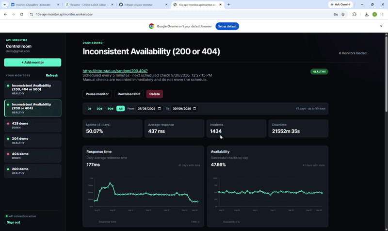

# 10x API Monitor

A full-stack uptime monitoring application for APIs and websites. Users can create and manage endpoint monitors, inspect availability and latency trends, review incidents, and export a reporting period as a PDF. Monitoring runs on scheduled Cloudflare Workers Cron Triggers, while Supabase provides authentication and persistent storage.



## Product overview

- Create, pause, update, and delete up to 25 monitors per account.
- Check public HTTP and HTTPS endpoints on configurable 5, 10, 15, or 30 minute schedules. A one-minute interval is available only when explicitly enabled for local development.
- Record response status, latency, timestamps, and classified failures (HTTP error, timeout, connection error, or unexpected error).
- Track monitor health through `HEALTHY`, `SUSPECTED_FAILURE`, and `DOWN` states. Two consecutive failed checks confirm an incident; a successful check returns the monitor to healthy and resolves an open incident.
- View availability, response-time, failure, HTTP-status, incident, and downtime information over a selectable period of up to 90 days.
- Download a PDF report with summary metrics, response-time and availability trends, and recent failure breakdowns.
- Configure incident-opened and incident-recovered notifications through HTTPS webhooks and an optional email-provider API.

## Architecture

| Area | Implementation |
| --- | --- |
| Dashboard | React 19, TypeScript, and Vite single-page application |
| API | TypeScript service running on Cloudflare Workers with Hono |
| Authentication | Supabase Auth; the browser sends a bearer access token and the Worker validates it |
| Persistence | Supabase PostgreSQL with row-level security, constraints, indexes, and database functions |
| Scheduling | Cloudflare Cron Triggers; due monitors are claimed atomically from PostgreSQL |
| Reports | PDF generation with `pdf-lib` |
| Validation | Zod schemas for monitor inputs, partial updates, date ranges, and pagination |
| API contract | OpenAPI 3.0 specification in [`docs/openapi.yaml`](docs/openapi.yaml) |

The frontend is built into `dist/frontend` and served as Cloudflare Worker assets. The same Worker handles `/health` and `/api/v1/*` requests.

## How monitoring works

1. A scheduled Worker invocation asks PostgreSQL to claim due monitors. The claim function uses row locks with `SKIP LOCKED`, advances each monitor's next scheduled time, and generates a slot-specific execution key. Concurrent invocations therefore do not claim the same due row at once.
2. The Worker checks claimed targets with bounded concurrency. Each request has a 10-second timeout. Redirects are followed manually, with each destination revalidated and a maximum of five redirects.
3. Results are inserted idempotently using a unique `(monitor_id, execution_key)` constraint.
4. A database transition function locks the monitor and result row, applies the health-state transition once, and opens or resolves an incident as appropriate. Its dedicated transition marker makes retries safe.
5. Notifications are attempted for incident-opened and incident-recovered events. Delivery is best effort, bounded by an eight-second timeout, and a failed notification does not undo monitoring results.

## Data retention and reporting

Raw check results are retained for 30 days. A daily scheduled database function aggregates older results into permanent per-day summaries before deleting the raw rows. Statistics and PDF reports combine those historical summaries with recent database-computed aggregates, avoiding double counting across the retention boundary. The statistics cache uses the Worker Cache API as an ephemeral optimization; the database remains the source of truth.

Statistics and reports accept inclusive UTC `from` and `to` dates with a maximum range of 90 days. The detailed checks endpoint reads raw checks, so it only returns records that remain within the raw retention window. Historical summary rows preserve daily counts, uptime, latency aggregates, incident counts, and downtime; failure-type and HTTP-status distributions are available from recent detailed checks.

## Technology and engineering highlights

- **Concurrency-safe scheduling and quotas:** PostgreSQL functions atomically claim due monitors and enforce the 25-monitor account limit under concurrent requests.
- **Idempotent state transitions:** Execution keys and row-level locking prevent duplicate check processing from generating duplicate state changes or incidents.
- **SSRF-aware destination validation:** Monitor and webhook URLs are validated against local/private literal destinations; redirects are rechecked, webhooks require HTTPS, and webhook redirects are rejected.
- **Per-user access control:** The API verifies Supabase access tokens, checks ownership for monitor resources, and the database applies row-level security policies.
- **Bounded work:** Scheduled batches, check concurrency, network timeouts, redirect depth, date ranges, pagination sizes, and endpoint rate limits are capped.
- **Historical analytics:** Retention aggregation preserves long-term daily reporting while pruning detailed check rows.
- **Transactional account limits:** Monitor creation uses a per-user transaction lock, so simultaneous create requests cannot exceed the 25-monitor quota.
- **Typed, strict implementation:** TypeScript strict mode covers Worker, frontend, and test sources; shared domain types keep the dashboard and API aligned.
- **Tested failure paths:** Unit tests exercise timeout and redirect behavior, private-target rejection, state/statistics calculations, PDF output, validation, and rate limiting.
- **Operational security headers:** Worker responses and static assets set content-security and browser security headers.

The API's in-memory rate limiter is best effort per Worker isolate, not a global distributed rate limiter. Database-enforced quota and scheduling constraints provide the cross-invocation guarantees.

## Prerequisites

- Node.js `>=22.12.0` and npm
- A Supabase project with email/password authentication enabled
- A Cloudflare account for deployment (Wrangler can run locally without deployment credentials)

## Local development

### 1. Install dependencies

```bash
npm install
```

### 2. Prepare Supabase

Apply the SQL migrations in order to your Supabase project:

1. `supabase/migration/0001_initial_schema.sql`
2. `supabase/migration/0002_recent_statistics_rpc.sql`

You can apply them through the Supabase SQL Editor or your preferred Supabase migration workflow. The first migration creates the tables, indexes, row-level security policies, and database functions used by the application; the second adds the recent-statistics aggregation function.

In Supabase Auth settings, configure the site URL and allowed redirect URLs for your local frontend and deployed app as appropriate.

### 3. Configure the Worker

Copy `.dev.vars.example` to `.dev.vars` and fill in your Supabase project URL, publishable key, and secret key. `.dev.vars` is ignored by Git. Keep the secret key server-side; never put it in a `VITE_*` variable or commit it.

The non-secret local Worker settings, including `APP_ORIGIN`, scheduler batch limits, and concurrency, are defined in `wrangler.toml` and `.env.example`. To try email notifications locally, provide `EMAIL_API_URL` and `EMAIL_API_KEY` in `.dev.vars`. The configured endpoint is expected to accept an authenticated JSON POST containing the event, recipient, and subject.

### 4. Configure the frontend

Copy `frontend/.env.example` to `frontend/.env.local` and set:

```dotenv
VITE_SUPABASE_URL=https://your-project-ref.supabase.co
VITE_SUPABASE_PUBLISHABLE_KEY=your-publishable-key
VITE_API_BASE_URL=http://127.0.0.1:8787/api/v1
```

Only browser-safe Supabase configuration belongs in this file. The Supabase secret key must remain in the Worker environment.

### 5. Run the Worker and dashboard

Use two terminals from the project root:

```bash
npm run dev
```

```bash
npm run dev:web
```

Wrangler serves the API locally at `http://127.0.0.1:8787`; Vite serves the dashboard at `http://localhost:5173`. The local Worker command sets its allowed app origin to the Vite URL.

For local testing only, set `ALLOW_ONE_MINUTE_INTERVAL=true` in `.dev.vars` to make the one-minute schedule available, and `ALLOW_MANUAL_CHECKS=true` to enable the authenticated on-demand check endpoint and dashboard control. These flags should not be enabled in the deployed environment. In deployment, scheduled checks run through Cron Triggers.

## Build and quality checks

```bash
npm run build
npm test
npm run lint
```

- `npm run build` type-checks the Worker and bundles the frontend.
- `npm test` runs the Vitest suite.
- `npm run lint` runs the TypeScript compiler without emitting files.
- `npm run test:watch` starts Vitest in watch mode.

Tests cover URL validation, redirect and timeout handling, failure classification, statistics aggregation, PDF generation, monitor validation, and rate-limit behavior.

## CI/CD

GitHub Actions (`.github/workflows/deploy.yml`) runs on pull requests targeting `main` and on pushes to `main`. Pull requests run the verification job: clean dependency installation, a moderate-severity npm audit, unit tests, TypeScript checks, required frontend-configuration checks, and a production build. A push to `main` runs verification first, then builds and deploys the Worker and frontend assets with Wrangler, followed by retries against the deployed `/health` endpoint. Workflow concurrency prevents overlapping main-branch deployments.

The workflow currently names its target **Deploy testing Worker** and checks `https://10x-api-monitor.apimonitor.workers.dev/health`; describe this as the configured testing deployment unless the Cloudflare target and health URL are intentionally changed for production. Configure these GitHub Actions repository variables for the frontend build: `VITE_SUPABASE_URL`, `VITE_SUPABASE_PUBLISHABLE_KEY`, and `VITE_API_BASE_URL`. Configure `CLOUDFLARE_API_TOKEN` and `CLOUDFLARE_ACCOUNT_ID` as GitHub Actions secrets. Supabase Worker secrets (including the server-side secret key and any email-provider credentials) must already be configured in the Cloudflare Worker environment; this workflow does not apply database migrations or provision those Worker secrets.

## Deploy to Cloudflare Workers

1. Apply both Supabase migrations and configure Supabase Auth URLs.
2. Set the Worker secrets in the Cloudflare/Wrangler environment:

   ```bash
   npx wrangler secret put SUPABASE_URL
   npx wrangler secret put SUPABASE_PUBLISHABLE_KEY
   npx wrangler secret put SUPABASE_SECRET_KEY
   ```

3. If email notifications are required, also set `EMAIL_API_URL` and `EMAIL_API_KEY` as Worker secrets. Configure a provider endpoint that accepts the JSON request described above.
4. Review `APP_ORIGIN` in `wrangler.toml` and set it to the deployed dashboard origin. The API CORS policy allows that configured origin.
5. Build and deploy:

   ```bash
   npm run build
   npm run deploy
   ```

The Worker configuration schedules monitor processing every five minutes and daily retention at 01:15 UTC. The configured batch size, number of batches, check concurrency, and statistics cache TTL are environment variables in `wrangler.toml`.

## Troubleshooting

- **The dashboard reports missing Supabase configuration or fails during startup:** Check that `frontend/.env.local` exists and contains the exact `VITE_SUPABASE_URL` and `VITE_SUPABASE_PUBLISHABLE_KEY` names. Restart Vite after changing environment variables. For GitHub Actions builds, set the same values as repository variables; the workflow fails early if any required browser variable is missing.
- **The browser shows a CORS/network error:** Confirm `APP_ORIGIN` exactly matches the dashboard origin, including scheme, hostname, and port. Local Worker development sets it to `http://localhost:5173`; deployed environments need their actual dashboard origin. Also check `VITE_API_BASE_URL` points to the corresponding Worker API base URL.
- **Sign-in, sign-up, or confirmation links do not return to the app:** Review Supabase Auth site URL and allowed redirect URLs for the local or deployed frontend origin, and check the project's email-confirmation settings.
- **API calls return 401 or monitor data is missing:** Sign in again to refresh the Supabase access token. Verify the frontend is configured for the same Supabase project as the Worker, and that the Worker has the matching Supabase URL and publishable key. The secret key belongs only in the Worker environment.
- **Monitor creation or statistics returns a database/RPC error:** Apply both SQL migration files, in order, to the Supabase project used by the Worker. The application depends on functions and tables created by those migrations; deploying the Worker does not apply them.
- **A target URL is rejected:** Monitor targets must use HTTP or HTTPS and cannot point to local or private literal addresses. Webhook destinations must use HTTPS. Redirect destinations are checked too, and webhook redirects are not followed.
- **A manual check returns 403, or a one-minute interval is unavailable:** Those options are deliberately gated by `ALLOW_MANUAL_CHECKS=true` and `ALLOW_ONE_MINUTE_INTERVAL=true` for local development. Scheduled monitoring in the deployed configuration runs from the five-minute Cron Trigger.
- **A new monitor has no check history yet:** Scheduled checks run on the five-minute cron schedule and then follow the monitor interval. Check that the monitor is enabled, the Worker Cron Trigger is deployed, and the target is publicly reachable. `/health` confirms the Worker responds; it does not verify Supabase connectivity or that a scheduled check has run.
- **Checks are present but old detailed history is not:** Raw check rows are pruned after 30 days. Use statistics or a PDF report for supported periods up to 90 days; older failure-type and HTTP-status breakdowns are not retained.
- **Notifications do not arrive:** Notification delivery is best effort and is not retried. For email, verify `EMAIL_API_URL`, `EMAIL_API_KEY`, the provider's expected JSON API contract, and the account email in Supabase Auth. For webhooks, verify the HTTPS endpoint accepts the JSON event. Delivery failures are logged without exposing recipient addresses, credentials, or webhook URLs.
- **Requests return 429:** Per-endpoint limits apply, and the account also has an atomic maximum of 25 monitors. The in-memory request limiter is per Worker isolate, so it is a best-effort abuse guard rather than a global quota.
- **GitHub deployment fails:** Check the Actions run for missing repository variables or secrets, ensure the Cloudflare token has permission to deploy Workers to the configured account, and confirm that the configured post-deploy health URL is the intended Worker. A successful build does not create or migrate the Supabase schema.

## API overview

All application endpoints are under `/api/v1`. Except for `/health`, requests require `Authorization: Bearer <supabase-access-token>`. Date filters use inclusive UTC calendar dates. The complete OpenAPI definition is in [`docs/openapi.yaml`](docs/openapi.yaml).

| Method | Endpoint | Description |
| --- | --- | --- |
| `GET` | `/health` | Worker health response (`{ "status": "ok" }`) |
| `GET` | `/api/v1/monitors` | List the authenticated user's monitors |
| `POST` | `/api/v1/monitors` | Create a monitor (maximum 25 per user) |
| `GET` | `/api/v1/monitors/{id}` | Get an owned monitor |
| `PATCH` | `/api/v1/monitors/{id}` | Update an owned monitor |
| `DELETE` | `/api/v1/monitors/{id}` | Delete an owned monitor |
| `GET` | `/api/v1/monitors/{id}/checks` | Paginated retained raw check history; optional `from`, `to`, `page`, and `limit` |
| `GET` | `/api/v1/monitors/{id}/incidents` | Paginated incident history |
| `GET` | `/api/v1/monitors/{id}/statistics` | Statistics series and summary; optional `from` and `to`, up to 90 days |
| `GET` | `/api/v1/monitors/{id}/report` | Download a PDF for the requested date range |
| `POST` | `/api/v1/monitors/{id}/check` | Authenticated immediate check; disabled unless `ALLOW_MANUAL_CHECKS=true` |

Monitor creation requires `name`, `url`, and `interval_minutes`. The URL must be HTTP or HTTPS and target a public destination. Webhook URLs must use HTTPS. Errors use a JSON envelope with `error.code` and `error.message`.

## Repository layout

```text
frontend/                  React dashboard and Vite configuration
src/routes/                Hono API routes
src/services/              Monitoring, scheduling, incidents, notifications, statistics, PDF reports
src/repositories/          Supabase persistence and ownership-scoped queries
src/lib/                   Authentication, validation, URL safety, caching, limits, errors
src/db/models.ts           Shared domain and API data types
supabase/migration/        PostgreSQL schema and database functions
tests/                     Vitest unit tests
docs/openapi.yaml          OpenAPI 3.0 API specification
docs/images/               Dashboard screenshots and walkthrough
wrangler.toml              Worker assets, cron triggers, and runtime configuration
```

## License

Kindly contact the project owner before reusing or redistributing this code.

Contact: h4hashimchoudhry@gmail.com


